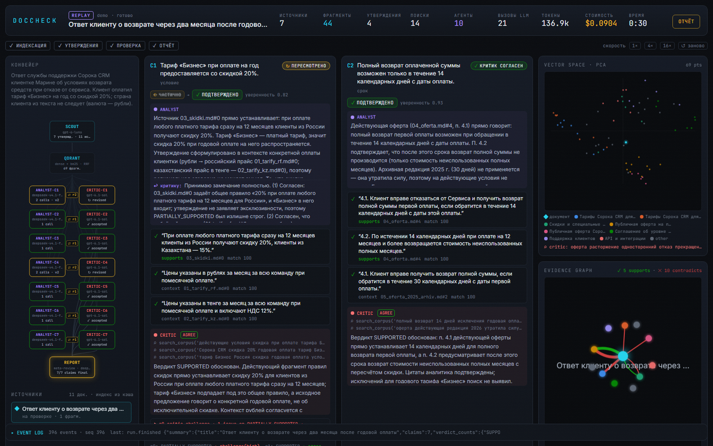
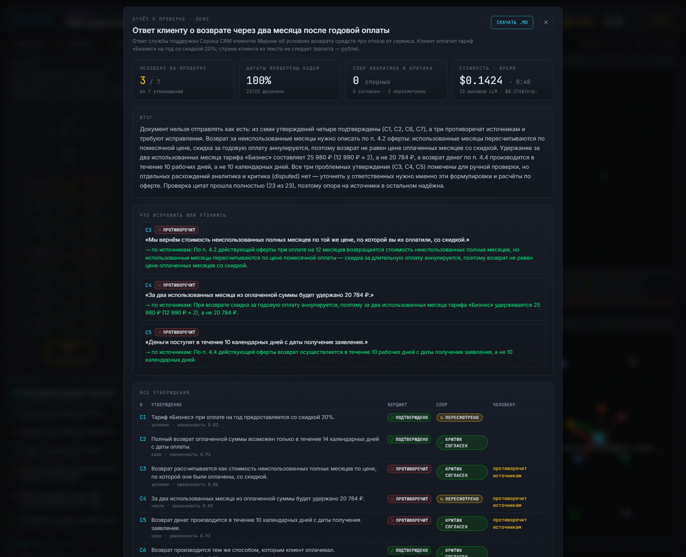

# DocCheck — проверка исходящих документов по источникам компании

**Мультиагентная система, которая находит ошибки в ответах клиентам, КП и памятках, сверяя каждое утверждение с тарифами, офертой и регламентами компании. Каждая цитата проверяется кодом, спорное уходит человеку.**

*Multi-agent fact-checking of outgoing business documents (support replies, commercial proposals, memos) against the company's own sources: Scout → Analyst ⇄ Critic, hybrid RAG on Qdrant with Russian embeddings, deterministic quote verification, MCP tools, local-model option, event-sourced replay. Python · FastAPI · Qdrant · React/TS.*



| | |
|---|---|
| **Ошибок поймано** (56 подложенных, 15 документов) | 100% (56/56) строго · 100% дошли до человека |
| **…на сложном наборе** (арифметика, «рабочие/календарные», исключения) | 100% (19/19) · только аналитик: 89% |
| **Ложные срабатывания** на верных утверждениях | 2% (1 из 58) |
| **Цитаты, подтверждённые кодом** | 100% (258/258) |
| **Стоимость** проверки документа | $0.14 (полный конвейер) · $0.015 (только аналитик) · $0 (локальный аналитик, 93% ошибок) |
| **Поиск нужного раздела**, recall@5 на перефразированных вопросах | 98% (multilingual-e5-large) против 44% у исходной англоязычной модели |

Все цифры — из [`evals/results.md`](evals/results.md) и [`evals/retrieval.md`](evals/retrieval.md), воспроизводятся скриптами. Корпус и набор синтетические (см. [Ограничения](#ограничения)).

## Зачем

Поддержка, пресейл и юристы каждый день отправляют наружу тексты с фактами: «тариф включает 50 пользователей», «возврат в течение 30 дней», «по п. 4.1 оферты…». Ошибка стоит денег или претензии. Проверять вручную долго, а LLM-ассистент сам галлюцинирует.

DocCheck берёт документ и папку с источниками компании и по каждому утверждению выдаёт вердикт:

| вердикт | когда |
|---|---|
| ✅ подтверждено | числа, сроки, условия, тариф и регион совпадают с действующими источниками |
| ❌ противоречит | другое число или срок, свойство другого тарифа или региона, условие из архивной редакции |
| 🟠 преувеличено | «на всех тарифах», «любому клиенту», «круглосуточно», хотя в источнике есть ограничения |
| 🟡 частично | верно лишь при условии, которое опущено |
| ❔ не найдено | в источниках этого нет; ссылка на несуществующий пункт |

К каждому вердикту — дословные цитаты (проверены кодом) и исправление «как правильно по источникам». Утверждения с ошибкой, спорные (аналитик и критик не договорились), с низкой уверенностью или с непрошедшей цитатой попадают в список «человеку на проверку».

## Как это работает

```
источники компании (MD/DOCX/PDF/HTML) → чанкинг по разделам → e5-large + BM25 (рус.) → Qdrant   [индекс один раз, по хэшу]
документ на проверку → SCOUT: контекст документа + утверждения (числа, сроки, условия, ссылки на пункты)
                         │
                         ▼  на каждое утверждение параллельно
      ANALYST  (без инструментов, контекст = гибридный поиск RRF) → вердикт + цитаты + исправление
        → GROUNDING CHECK (rapidfuzz ≥ 90, без LLM): цитата дословно есть в указанном фрагменте?
        → CRITIC (модель другого вендора, tool calling: search_corpus / get_chunk) ⇄ пересмотр, до 2 раундов
                         │
                         ▼
REPORT: вердикты, исправления, «человеку на проверку», стоимость, время  →  report.md / report.json
события → runs/<id>/events.jsonl + SSE → UI (React + TS): live или replay без сети и без ключа
```

- **Scout** (`gpt-6-luna`) выписывает проверяемые утверждения и одну строку контекста документа (кому, какая страна, какой тариф), чтобы проверяющие не придирались к очевидному.
- **Analyst** (`deepseek-v4.1-flash` или локальная модель) судит по фиксированному контексту и не имеет инструментов: его ответ воспроизводим и дешёв.
- **Grounding check** — детерминированная проверка каждой цитаты (`rapidfuzz.partial_ratio ≥ 90`, нормализация «ёлочек», ё/е, неразрывных пробелов). Это факт, а не мнение модели: с ним не спорят ни аналитик, ни критик.
- **Critic** (`gpt-6.1-sol`, другой вендор) ищет опровержения сам: другой тариф, другой регион, действующая редакция вместо архивной, арифметика. CHALLENGE с замечанием medium/high запускает пересмотр.
- **Report** решает, что показать человеку, по прозрачному правилу, а не по мнению LLM.

### Почему без LangChain/LangGraph

Оркестратор — ~300 строк asyncio ([`doccheck/orchestrator.py`](doccheck/orchestrator.py)): каждый шаг — явный вызов функции, каждое действие — типизированное событие. Отсюда три свойства, которые важны в проде: **стоимость предсказуема** (видно каждый вызов и его цену), **отладка по журналу событий** (любой прогон воспроизводится в UI без сети), **нет скрытых промптов фреймворка**. Граф Analyst ⇄ Critic легко переносится на LangGraph, если этого требует стек заказчика.

**LangGraph-версия для сравнения** (ветка `langgraph`, [`doccheck/graph.py`](doccheck/graph.py), 104 строк). Спор по одному утверждению оформлен как `StateGraph`: `analyze → ground → critic → (revise → ground … | END)`. Роли, промпты, проверка цитат и события остались прежними. Включается переменной `DOCCHECK_ORCHESTRATOR=langgraph`. Офлайн e2e-тест прогоняет оба оркестратора на одних и тех же записанных ответах LLM и получает одинаковые вердикты. Вывод: граф делает переходы декларативными и даёт готовые чекпоинты и human-in-the-loop, но добавляет зависимость и слой состояния. Для конвейера из четырёх шагов собственный цикл короче и проще в отладке, поэтому по умолчанию остаётся он.

## Результаты

### Ловля ошибок ([`evals/results.md`](evals/results.md))

15 документов: 10 базовых и 5 сложных. В них 56 подложенных ошибок 9 типов и 47 верных утверждений, которые проверяют ложные срабатывания. Все конфигурации проверялись на **одних и тех же утверждениях Scout** (`--reuse-claims`), поэтому модели сравниваются честно.

| конфигурация | ошибок поймано (строго) | …в сложном наборе | дошли до человека | ложные срабатывания на верных | $ / документ |
|---|---|---|---|---|---|
| только Analyst (`deepseek-v4.1-flash`) | 96% (54/56) | 89% (17/19) | 100% | 5% (3/58) | $0.015 |
| Analyst ⇄ Critic, v1 | 95% (53/56) | 89% | 100% | 5% (3/58) | $0.22 |
| **Analyst ⇄ Critic, v2** (после правки стандарта доказательств) | **100% (56/56)** | **100% (19/19)** | 100% | **2% (1/58)** | $0.14 |

Цитаты, проверенные кодом: 100% во всех прогонах (258 из 258 в v2). Время — около 50 с на документ при 4 параллельных утверждениях.

Что видно из таблицы:

- **Базовые ошибки** (не то число, не тот тариф или регион, архивная редакция) ловит один аналитик: 37 из 37 за полтора цента на документ. Для потока простых ответов поддержки этого достаточно.
- **Критик нужен на сложных случаях.** Две арифметические ошибки («за два месяца удержим 20 784 ₽») аналитик пометил как «не найдено»: цена тарифа лежала в другом фрагменте. Критик сам нашёл прайс через `search_corpus`, пересчитал (2 × 12 990 = 25 980 ₽) и доказал противоречие.
- **Первая версия критика вредила.** В v1 он в трёх случаях переубедил аналитика сменить верное «противоречит» на «не найдено» из-за формальных сомнений вроде «регион клиента явно не назван». Тот же педантизм давал ложные срабатывания. Правка — различать «источник говорит иначе» и «источник молчит», а для смены вердикта требовать цитату. После неё recall 95% → 100%, ложные срабатывания 5% → 2%, стоимость $0.22 → $0.14: меньше бесполезных раундов спора.
- Оставшееся ложное срабатывание — пограничный случай: «при оплате на год перенесём 50 000 записей бесплатно» верно только для тарифа «Бизнес», а в КП этот тариф назван в другом абзаце.

### Поиск ([`evals/retrieval.md`](evals/retrieval.md))

Два набора запросов: утверждения из документов (лексически близки к корпусу) и 45 перефразированных разговорных вопросов («Передумали через неделю — деньги вернут целиком?»).

| модель эмбеддингов | утверждения, hybrid recall@5 | перефраз, dense recall@5 | перефраз, hybrid recall@5 |
|---|---|---|---|
| bge-small-en-v1.5 (исходная модель TRIAD) | 100% | 20% | 44% |
| paraphrase-multilingual-MiniLM-L12-v2 | 98% | 78% | 78% |
| paraphrase-multilingual-mpnet-base-v2 | 100% | 82% | 73% |
| **multilingual-e5-large** (по умолчанию) | **100%** | **98%** | **98%** |
| только BM25 (русский стеммер) | 100% | — | 56% |

Вывод: на формулировках, близких к корпусу, хватает и BM25. Разница между моделями видна, когда человек спрашивает своими словами. Для e5 на перефразе чистый dense даёт recall@1 80% против 60% у гибридного поиска: BM25 тянет вниз. Конвейер ищет по утверждениям, а не по вопросам, поэтому по умолчанию остался гибридный поиск.

### Конфиденциальность: локальная модель

Analyst переключается на любой OpenAI-совместимый endpoint (LM Studio, Ollama, vLLM) двумя переменными. Тогда документы не уходят во внешнее API на этапе анализа, а при локальных Scout и Critic — вообще никуда.

```bash
DOCCHECK_ANALYST_BASE_URL=http://127.0.0.1:1234/v1 DOCCHECK_ANALYST_MODEL=mistralai/devstral-small-2-2512 \
  uv run python -m doccheck check data/eval/docs/d02_kp_logistika.md
```

Замер на тех же утверждениях: Analyst = `mistralai/devstral-small-2-2512` (24B, Q4) в LM Studio на RTX 4060 Ti 16 ГБ, контекст 6144, без критика.

| Analyst без критика | ошибок поймано | …в сложном наборе | дошли до человека | ложные срабатывания | верные → человеку | цитаты | $ / документ | время / документ |
|---|---|---|---|---|---|---|---|---|
| `deepseek-v4.1-flash` (API) | 96% | 89% | 100% | 5% | 7% | 100% | $0.015 | ~1,3 мин |
| `devstral-small-2` (локально) | 93% | 84% | 100% | **0%** | 16% | 97% (154/158) | **$0** | ~2,4 мин |

Локальная модель осторожнее: она реже утверждает «противоречит», чаще ставит «частично» и низкую уверенность. Поэтому ложных срабатываний нет, но человеку уходит больше верных утверждений (16% против 7%). Сильнее всего она проседает на арифметике (3 из 5) и на четырёх цитатах, неточных на одно-два слова: их отсёк grounding check. Ни одна подложенная ошибка не прошла мимо человека. Итог: −3 п. п. строгого recall, расходы на LLM на этапе анализа — ноль, документы не покидают машину.

## Быстрый старт

### Посмотреть за 2 минуты (без ключа)

```bash
git clone https://github.com/Sinerror/doccheck && cd doccheck
docker compose up -d --build
```

Откройте http://localhost:8000 и нажмите **▶ Replay** у прогона `demo`: это записанная проверка ответа клиенту о возврате, где критик сам пересчитывает сумму удержания и опровергает аналитика.



### Разработка

Нужны `uv`, Node ≥ 20 и Qdrant (`docker run -d -p 127.0.0.1:6333:6333 qdrant/qdrant`).

```bash
cp .env.example .env                       # DOCCHECK_LLM_API_KEY = ключ любого OpenAI-совместимого API
uv sync && npm --prefix web install
uv run uvicorn doccheck.api:app --port 8000
npm --prefix web run dev                   # http://localhost:5173
```

CLI:

```bash
uv run python -m doccheck index                                  # проиндексировать data/corpus (один раз)
uv run python -m doccheck check path/to/reply.docx --run-id my   # отчёт: runs/my/report.md
uv run python -m doccheck check reply.md --no-critic             # дёшево: только аналитик
```

Свой корпус — это папка с `.md / .txt / .html / .docx / .pdf` (`DOCCHECK_CORPUS_DIR`). Разделы берутся из заголовков документа.

### MCP

Инструменты критика доступны любому MCP-клиенту (Claude Desktop, IDE-агенты): `search_corpus`, `get_chunk`, `check_quote`, `list_sources`.

```bash
uv run python -m doccheck.mcp_server              # stdio
uv run python -m doccheck.mcp_server --http 8765  # streamable HTTP, 127.0.0.1:8765/mcp
```

## API

| метод | путь | |
|---|---|---|
| POST | `/api/runs` | JSON `{text, title?}` или `{example}`, либо multipart с `file`; опции `max_claims`, `debate_rounds`, `use_critic`, `callback_url` → `{run_id}` |
| GET | `/api/runs/{id}/events` | live SSE |
| GET | `/api/runs/{id}/replay?speed=4` | SSE-повтор записанного прогона (без ключа и без Qdrant) |
| GET | `/api/runs`, `/api/runs/{id}/report`, `/api/runs/{id}/report.md`, `/api/runs/{id}/vector-map` | |
| GET | `/api/examples`, `/api/corpus`, `/api/health` | |

`callback_url` позволяет встроить проверку в n8n или любой workflow: отчёт придёт POST-запросом, когда проверка закончится.

## Качество кода

```bash
uv run pytest                                   # 70 тестов: офлайн e2e на записанных ответах LLM, Qdrant in-memory
uv run python scripts/eval_retrieval.py         # сравнение эмбеддингов, бесплатно, ~5 мин на CPU
uv run python scripts/eval_planted.py --label full                                  # полный eval, ~$5
uv run python scripts/eval_planted.py --label a --no-critic --reuse-claims <eval id>  # только аналитик, ~$0.2
npm --prefix web run build                      # tsc --noEmit + vite build
```

TS-типы событий генерируются из Python-моделей (`scripts/gen_ts_types.py`), так что контракт бэкенд ↔ UI не расходится.

## Инженерные находки

- **Критик-скептик ухудшал вердикты** — см. «Результаты»: правило «источник говорит иначе ≠ источник молчит» и требование цитаты для смены вердикта дали +5 п. п. recall и −3 п. п. ложных срабатываний при меньшей стоимости. Обе версии лежат в истории прогонов.
- **Контекст документа против ложных срабатываний.** В первом прогоне аналитик помечал «12 990 ₽ за всю команду» как преувеличение: в утверждении не был указан регион. Scout теперь выписывает одну строку контекста (КП российской компании, тариф «Бизнес»), её видят аналитик и критик. Ложные срабатывания на этом документе ушли.
- **Корпус индексируется один раз.** Скоуп в Qdrant — хэш содержимого папки плюс модель эмбеддингов. e5-large на CPU индексирует корпус ~70 с, следующие прогоны берут индекс из кэша. Документ на проверке удаляется из индекса после прогона.
- **LM Studio не принимает `tool_choice` с именем функции**, только `"required"`. Для структурированного вывода с одним инструментом это эквивалентно; адаптация живёт в одном месте ([`doccheck/llm.py`](doccheck/llm.py)).
- Из исходного проекта TRIAD (рецензент научных статей, из которого вырос DocCheck):
  - роутер игнорирует `max_tokens` у `gpt-6.1-sol` (лимит 40 — пришло 1878 токенов): сделан клиентский ограничитель стрима с повтором на `reasoning_effort=low`;
  - `localhost` на Windows сначала резолвится в IPv6: 2,03 с на каждый вызов Qdrant против 0,004 с с `127.0.0.1`;
  - учёт стоимости совпал с биллингом роутера ($0,238 = $0,238).

## Структура

```
doccheck/        orchestrator.py · llm.py · events.py · grounding.py · report.py · api.py · mcp_server.py
  roles/         scout.py · analyst.py · critic.py          prompts/*.md (промпты — файлы, на русском)
  rag/           qdrant_store.py · embed.py · chunking.py · corpus.py
  sources/       local.py (MD/TXT/HTML/DOCX) · pdf.py
data/corpus/     11 документов вымышленной «Сорока CRM»: тарифы РФ/КЗ, оферта + архивная редакция, SLA, …
data/eval/       15 документов на проверку, labels.json, перефразированные вопросы
evals/           results.md · retrieval.md · история прогонов (JSON)
scripts/         build_eval_set.py · eval_planted.py · eval_retrieval.py · gen_ts_types.py
web/             Vite + React + TS + Tailwind · framer-motion · @xyflow/react
runs/demo/       записанный прогон для Replay
```

## Ограничения

- **Данные синтетические.** Корпус и документы с ошибками написаны автором системы: вымышленная компания «Сорока CRM», намеренные ловушки (похожие тарифы, региональные отличия, архивная редакция оферты). Цифры показывают поведение на этих типах ошибок, а не точность на реальных документах конкретной компании.
- **Один прогон на конфигурацию.** Модели стохастические, разброс между прогонами не измерен. Скрипт `eval_planted.py` копит историю прогонов и считает среднее ± sd, если запустить его повторно.
- **Данные уходят во внешнюю модель**, если не включена локальная. Локальный режим замерен только для аналитика; Scout и Critic на локальных моделях не проверялись.
- **Таблицы в PDF** разбираются как текст. DOCX-таблицы попадают в отдельный раздел построчно.
- Время проверки — минуты, не секунды: критик с инструментами — самая медленная и дорогая часть. Для потока документов есть режим `--no-critic` (в ~9 раз дешевле), критика можно включать только для КП и юридически значимых текстов.

## Лицензия

MIT
